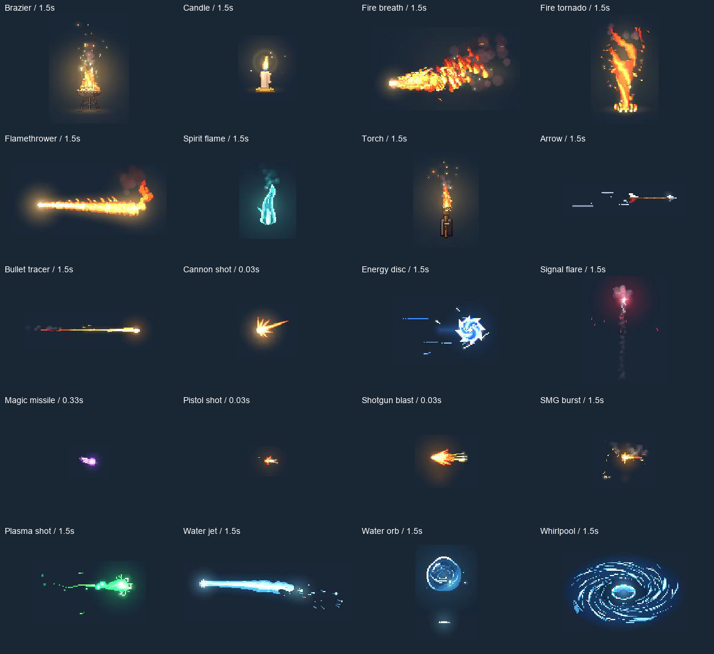

# PixelFX for Godot

[](https://github.com/norvancc/pixelfx-godot/actions/workflows/ci.yml)
[](LICENSE)
[](https://github.com/norvancc/pixelfx-godot/releases)

**An unofficial Godot port of [patch-gg/pixelfx](https://github.com/patch-gg/pixelfx): procedural pixel effects rendered natively in GDScript.**

[中文说明](README.zh-CN.md) · [Quick start](#quick-start) · [API](addons/pixelfx/docs/API.md) · [Add an effect](docs/AUTHORING.md) · [Roadmap](ROADMAP.md)



[Watch the 20-effect native preview](https://github.com/user-attachments/assets/f7feadf1-6fd1-4d19-8569-fe567e98bd2b)

Based on upstream **PixelFX 0.3.0**, pinned at [`a841596`](https://github.com/patch-gg/pixelfx/tree/a84159688af3ca37a4be05a0d422b94451b2e24e). Original work by Patch and Hugo Duprez; see [attribution](NOTICE.md) and [source hashes](addons/pixelfx/provenance.json). This project is independently maintained and is not an official upstream release.

## Status

**The current source includes 39 native effects; the latest published release, 0.2.0, contains five.** The pinned upstream catalog contains 244 effects; 205 remain. Arcane Fireball is a palette preset and does not count as another algorithm.

The first B2 slice added 20 native ports: seven fire effects, ten projectiles/muzzle effects and three water effects. The source catalog now contains **39/244** effects (205 remaining). That first slice has five stateful ports and fifteen analytic loops. See the [B2 acceptance record](addons/pixelfx/validation/b2.json) and run `demos/pixelfx/b2_gallery.tscn`. A second B2 slice adds eight analytic ice/water effects; B2 is 28/49 complete, with 21 effects still pending. See the [ice/water review](docs/plans/b2-elements-review.zh-CN.md) and [acceptance record](addons/pixelfx/validation/b2-elements.json). These source additions have not been released as a new version.

B1 adds six probe effects with upstream RGBA comparisons, native visual evidence and lifecycle tests. See the [migration ledger](docs/migration-status.json) and [B1 acceptance record](addons/pixelfx/validation/b1.json).

| Source batch | Algorithms | Lifecycle | Demo scene |
| --- | ---: | --- | --- |
| B0 / release 0.2.0 | 5 | 5 analytic loops | `demos/pixelfx/gallery.tscn` |
| B1 / unreleased | 6 | 2 analytic loops, 4 stateful one-shots | `demos/pixelfx/b1_gallery.tscn` |
| B2 first slice / unreleased | 20 | 15 analytic loops, 5 stateful one-shots | `demos/pixelfx/b2_gallery.tscn` |
| B2 ice/water / unreleased | 8 | 8 analytic loops | `demos/pixelfx/b2_elements_gallery.tscn` |

The source contains **39 algorithms / 40 presets**: **30 analytic loops and 9 stateful one-shots**. See the [complete effect and preset catalog](addons/pixelfx/docs/CATALOG.md). All support palette/auxiliary colors, seed, light, playback controls and native transforms. Stateful effects keep independent simulations, finish automatically and restart on parameter changes; seek, shared-frame caching and prewarming are unavailable for them. Games own projectile movement, impact and damage; actor choreography remains outside these batches.

The renderer generates pixels on the CPU and uploads textures to Godot. It is **not a GPU shader port**, a JavaScript wrapper, or a collection of prerecorded sprite sheets. Runtime frame sharing caches generated samples.

- Typed `.tres` presets, validated parameters and per-instance overrides.
- `PixelFXPlayer2D`: play, pause, restart, seek for analytic effects, speed, looping, fade, completion and cancellation.
- Front/back layers from one simulation; native Node2D positioning, rotation, scale and mirroring.
- Optional bounded LRU cache, incremental prewarming and a bounded player pool.
- Editor preview with automatically discovered effects, Inspector controls, timeline and explicit preset saving.
- Standalone demo, projectile integration example, extension template, tests and packaging tools.

Target: **Godot 4.3+**. The current ice/water slice is validated on Godot 4.7.2 / macOS / GL Compatibility; its Linux CI is pending. The previous 31-effect snapshot passed [Godot 4.3 / Ubuntu headless CI](https://github.com/norvancc/pixelfx-godot/actions/runs/42574117517). Other versions/platforms are not automatically covered. No C#, GDExtension, Autoload, Node.js or external textures are required at runtime.

## Quick start

1. For the five released effects, download `pixelfx-addon-0.2.0.zip` from [Releases](https://github.com/norvancc/pixelfx-godot/releases). For all 39 accepted source effects, clone this repository at `main` and use its `addons/pixelfx` directory.
2. Copy `addons/pixelfx` into your project's `addons` directory.
3. Optionally enable **PixelFX** under **Project → Project Settings → Plugins** for the preview panel. Runtime works with the plugin disabled.
4. Add a `PixelFXPlayer2D` node and assign `addons/pixelfx/presets/fireball.tres` to **Effect**.

Or instantiate it in code:

```gdscript
const FIREBALL = preload("res://addons/pixelfx/presets/fireball.tres")

func spawn_visual(at: Vector2) -> PixelFXPlayer2D:
    var fx := PixelFXPlayer2D.new()
    fx.autoplay = false
    fx.effect = FIREBALL
    fx.free_when_finished = true
    add_child(fx)
    fx.global_position = at
    fx.play({"radius": 7.0})
    return fx

# On impact, call fx.stop(): fade out, emit finished and free the node.
# The game owns movement, collision and damage; see the projectile example.
```

To run the demo, clone this repository, import `project.godot` in Godot and press **F5** for the five-effect gallery. The original fireball demo remains available at `demos/pixelfx/fireball_demo.tscn`. Open the **PixelFX** bottom panel to edit a private preset copy; **Save preset** writes your changes to a `.tres` file. No external game project is needed. The gallery's **B1**, **B2** and **B2 ice/water** buttons open the corresponding galleries; those scenes can also run directly using the paths in the table above.

## Add effects without editing the framework

Copy `addons/pixelfx/templates/effect.gd.txt` to `res://pixelfx/my_effect.gd`, then implement metadata, parameter schema, pixel bounds and drawing. The editor discovers the module automatically; the same player, cache and preset UI handle it. Stateful modules can implement `update()` and use isolated simulation state.

Effect-specific helpers and upstream simulation/acting dependencies may still need porting. The extension API does not mean the upstream character/rig/act systems have already been migrated.

- [Effect authoring (English)](docs/AUTHORING.md)
- [All 39 effects and presets](addons/pixelfx/docs/CATALOG.md)
- [Detailed API (中文)](addons/pixelfx/docs/API.md)
- [Effect contract (中文)](addons/pixelfx/docs/EFFECTS.md)
- [Performance and compatibility](addons/pixelfx/docs/PERFORMANCE.md)
- [Validation record](addons/pixelfx/VALIDATION.md)
- [Changelog](CHANGELOG.md)

## Performance

The five effects in release 0.2.0 averaged approximately **3.7–28 ms** per cold frame on the tested M4 Pro. B1/B2 have separate measurements: some CPU workloads exceed the 33.3 ms budget for 30 FPS. B2 measures four default lifecycle samples per effect, not exhaustive peaks. See [performance and compatibility](addons/pixelfx/docs/PERFORMANCE.md) and the batch acceptance records for the workload and limits. Prewarm common analytic presets during loading. The default Fireball cycle uses about **6.5 MiB** of estimated cache memory; the shared cache defaults to **32 MiB / 256 frames**.

A warm-cache CPU benchmark with 64 synchronized, identical instances averaged about 0.20 ms per update. This excludes complete scene GPU composition and is **not** a claim that arbitrary 64-effect workloads meet a frame-rate target. Stateful effects and unique parameters have different costs.

## Development

Install Godot, Python 3.10+ and Node.js 18+. Node.js is used only to generate reference pixels from the original JavaScript implementation.

```sh
# Point GODOT_BIN at a Godot executable if it is not available as `godot`.
python3 tools/pixelfx/check.py
python3 tools/pixelfx/package_demo.py
```

The check downloads the pinned upstream commit and verifies source hashes, then runs pixel parity, runtime, editor integration and performance checks. It does not fetch or execute arbitrary latest upstream versions. Generated files go into ignored `builds/` directories.

Current source validation preserves **447 baseline + 809 B1 + 2607 first-B2 + 1052 ice/water = 4915 upstream RGBA comparisons**. The latest gate also passes 70 baseline, 136 B1 and 419 B2 runtime checks; 329 existing and 431 B2 catalog checks; 159 editor checks; and 384 B1 / 320 B2 replays. The ice/water slice adds 167 runtime checks, 333 catalog/bounds checks and 128 replays, with 722 byte-exact cases and 66 individually audited tolerance exceptions; its local full gate passed. The first B2 slice has 2470 byte-exact cases and eight audited exceptions. [PR #6](https://github.com/norvancc/pixelfx-godot/pull/6) and its [Godot 4.3/Linux CI](https://github.com/norvancc/pixelfx-godot/actions/runs/42574117517) passed at implementation commit `73560f4`; merge commit `112d5d4` contains the same accepted source tree. Native visual evidence and platform limits are recorded in [VALIDATION.md](addons/pixelfx/VALIDATION.md).

## Contributing and license

See [CONTRIBUTING.md](CONTRIBUTING.md), [Code of Conduct](CODE_OF_CONDUCT.md), [Security](SECURITY.md) and [Support](SUPPORT.md). Please check the roadmap before starting a large port.

MIT licensed. Preserve the original copyright notices when redistributing. Upstream gallery fonts and character artwork are not bundled; see [NOTICE.md](NOTICE.md).

Documentation and repository layout: [documentation index](docs/README.md).
