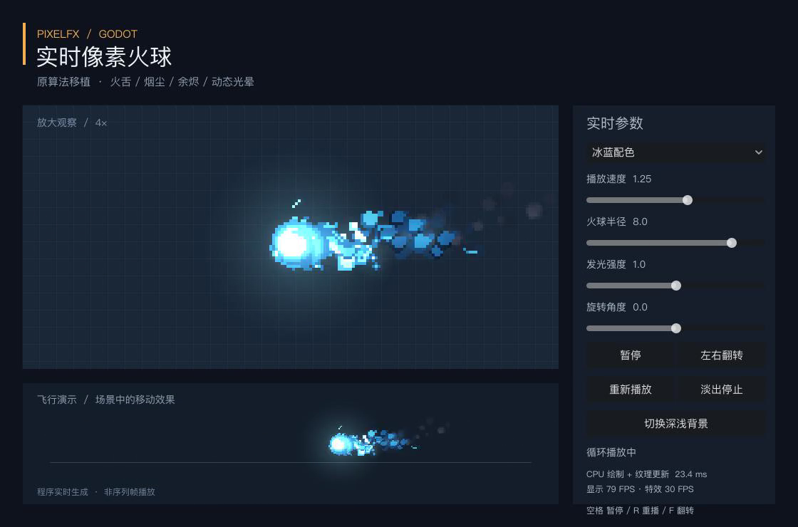

# PixelFX for Godot

[](https://github.com/norvancc/pixelfx-godot/actions/workflows/ci.yml)
[](LICENSE)
[](https://github.com/norvancc/pixelfx-godot/releases)

**An unofficial Godot port of [patch-gg/pixelfx](https://github.com/patch-gg/pixelfx): procedural pixel effects rendered natively in GDScript.**

[中文说明](README.zh-CN.md) · [Quick start](#quick-start) · [API](addons/pixelfx/docs/API.md) · [Add an effect](docs/AUTHORING.md) · [Roadmap](ROADMAP.md)



Based on upstream **PixelFX 0.3.0**, pinned at [`a841596`](https://github.com/patch-gg/pixelfx/tree/a84159688af3ca37a4be05a0d422b94451b2e24e). Original work by Patch and Hugo Duprez; see [attribution](NOTICE.md) and [source hashes](addons/pixelfx/provenance.json). This project is independently maintained and is not an official upstream release.

## Status

**0.1.0 is an early release: one ported effect (Fireball), with reusable addon infrastructure.** The upstream catalog contains 244 effects; the other 243 are not implemented here. Arcane Fireball is a preset, not a second algorithm.

The renderer generates pixels on the CPU and uploads textures to Godot. It is **not a GPU shader port**, a JavaScript wrapper, or a collection of prerecorded sprite sheets. Runtime frame sharing caches generated samples.

- Typed `.tres` presets, validated parameters and per-instance overrides.
- `PixelFXPlayer2D`: play, pause, restart, seek for analytic effects, speed, looping, fade, completion and cancellation.
- Front/back layers from one simulation; native Node2D positioning, rotation, scale and mirroring.
- Optional bounded LRU cache, incremental prewarming and a bounded player pool.
- Editor preview with automatically discovered effects, Inspector controls, timeline and explicit preset saving.
- Standalone demo, projectile integration example, extension template, tests and packaging tools.

Target: **Godot 4.3+**. Validated on Godot 4.7.2 / macOS / GL Compatibility and [Godot 4.3 / Ubuntu headless CI](https://github.com/norvancc/pixelfx-godot/actions/runs/42019538955). Other versions/platforms are not automatically covered. No C#, GDExtension, Autoload, Node.js or external textures are required at runtime.

## Quick start

1. Download `pixelfx-addon-0.1.0.zip` from [Releases](https://github.com/norvancc/pixelfx-godot/releases).
2. Copy `addons/pixelfx` into your project's `addons` directory.
3. Optionally enable **PixelFX** under **Project → Project Settings → Plugins** for the preview panel. Runtime works with the plugin disabled.
4. Add a `PixelFXPlayer2D` node and assign `addons/pixelfx/presets/fireball.tres` to **Effect**.

Or instantiate it in code:

```gdscript
const FIREBALL = preload("res://addons/pixelfx/presets/fireball.tres")

func spawn_visual(at: Vector2) -> PixelFXPlayer2D:
    var fx := PixelFXPlayer2D.new()
    fx.autoplay = false
    fx.effect = FIREBALL
    fx.free_when_finished = true
    add_child(fx)
    fx.global_position = at
    fx.play({"radius": 7.0})
    return fx

# On impact, call fx.stop(): fade out, emit finished and free the node.
# The game owns movement, collision and damage; see the projectile example.
```

To run the demo, clone this repository, import `project.godot` in Godot and press **F5**. Open the **PixelFX** bottom panel to edit a private preset copy; **Save preset** writes your changes to a `.tres` file. No external game project is needed.

## Add effects without editing the framework

Copy `addons/pixelfx/templates/effect.gd.txt` to `res://pixelfx/my_effect.gd`, then implement metadata, parameter schema, pixel bounds and drawing. The editor discovers the module automatically; the same player, cache and preset UI handle it. Stateful modules can implement `update()` and use isolated simulation state.

Effect-specific helpers and upstream simulation/acting dependencies may still need porting. The extension API does not mean the upstream character/rig/act systems have already been migrated.

- [Effect authoring (English)](docs/AUTHORING.md)
- [Detailed API (中文)](addons/pixelfx/docs/API.md)
- [Effect contract (中文)](addons/pixelfx/docs/EFFECTS.md)
- [Performance and compatibility](addons/pixelfx/docs/PERFORMANCE.md)
- [Validation record](addons/pixelfx/VALIDATION.md)
- [Changelog](CHANGELOG.md)

## Performance

On the locally tested M4 Pro, first generation with a new parameter combination costs approximately **20 ms**. Prewarm common presets during loading. The default Fireball cycle uses about **6.5 MiB** of estimated cache memory; the shared cache defaults to **32 MiB / 256 frames**.

A warm-cache CPU benchmark with 64 synchronized, identical instances averaged about 0.20 ms per update. This excludes complete scene GPU composition and is **not** a claim that arbitrary 64-effect workloads meet a frame-rate target. Stateful effects and unique parameters have different costs.

## Development

Install Godot, Python 3.10+ and Node.js 18+. Node.js is used only to generate reference pixels from the original JavaScript implementation.

```sh
# Point GODOT_BIN at a Godot executable if it is not available as `godot`.
python3 tools/pixelfx/check.py
python3 tools/pixelfx/package_demo.py
```

The check downloads the pinned upstream commit and verifies source hashes, then runs pixel parity, runtime, editor integration and performance checks. It does not fetch or execute arbitrary latest upstream versions. Generated files go into ignored `builds/` directories.

Local release validation passed **78 rendering cases, 70 runtime checks and 11 editor checks**. Six rendering cases differ by a small number of channels at 1/255; the exact tolerance and evidence are documented. macOS export was also launched locally. Cross-platform and aesthetic acceptance remain separate checks.

## Contributing and license

See [CONTRIBUTING.md](CONTRIBUTING.md), [Code of Conduct](CODE_OF_CONDUCT.md), [Security](SECURITY.md) and [Support](SUPPORT.md). Please check the roadmap before starting a large port.

MIT licensed. Preserve the original copyright notices when redistributing. Upstream gallery fonts and character artwork are not bundled; see [NOTICE.md](NOTICE.md).
