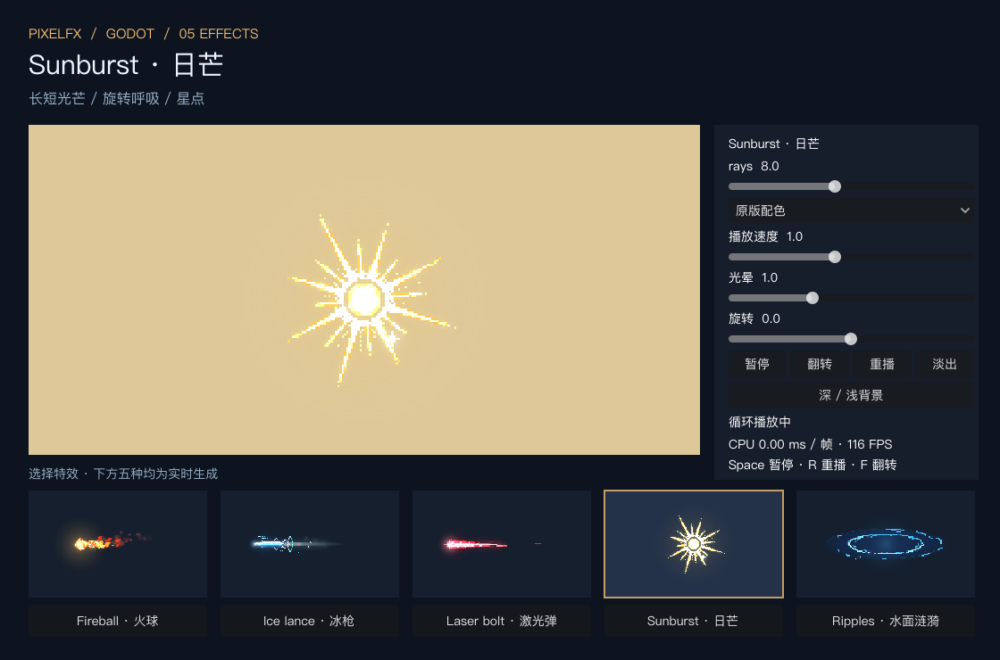

# PixelFX for Godot

**基于 [patch-gg/pixelfx](https://github.com/patch-gg/pixelfx) 的非官方 Godot 移植。** 原作者为 Patch 与 Hugo Duprez，采用 MIT 协议；此仓库由 norvancc 独立维护。

[English](README.md) · [发行包](https://github.com/norvancc/pixelfx-godot/releases) · [API](addons/pixelfx/docs/API.md) · [新增特效](addons/pixelfx/docs/EFFECTS.md)

## 当前状态

0.2.0 包含五种原算法移植：Fireball 火球、Ice lance 冰枪、Laser bolt 激光弹、Sunburst 日芒、Ripples 水面涟漪。上游固定版本共 244 个效果，另外 239 个尚未移植。Arcane Fireball 是调色预设，不计为额外效果。

五种均可调色、变速、暂停、定位时间、翻转与淡出；涟漪有前后分层。这批均为循环效果，移动、命中和停止时机由游戏负责。

当前源码新增了 B1 六项：Hit spark 命中火花、Poof 消散烟团、Campfire 篝火、Rocket 火箭、Small explosion 爆炸和 Splash 水花，该批累计 11 项；这些新增项尚未发布为发行包。四个有状态一次性效果会自动结束，调参会重播，不支持 seek 或预热；篝火和火箭为解析循环。

本次 B2 新增 20 项，涵盖 7 项火焰、10 项弹体/枪口和 3 项水系，源码累计 **31/244** 项，剩余 213 项。5 项使用独立模拟实例，15 项为解析循环；水球支持前后层。列表、像素误差、运行/视觉与性能证据见 [B2 验收记录](addons/pixelfx/validation/b2.json) 和 [本批说明](docs/plans/b2-twenty-review.zh-CN.md)。

验收含新增 809 组上游 RGBA 对照、原生深浅背景及镜像录制、生命周期/边界/编辑器检查。具体误差与性能见 [B1 验收记录](addons/pixelfx/validation/b1.json)；存在少量逐案例登记的浮点差异，不声称全部像素完全一致。

这是真正的 GDScript CPU 程序生成，生成后通过纹理交给 Godot 绘制；不是 GPU Shader 移植、JS 包装或预录图集。运行时不依赖 Node.js、C#、Autoload 或外部图片。

已包含预设资源与参数校验、实例隔离、完整播放控制、前后分层、共享缓存、预热、对象池、编辑器实时预览、时间轴、调参保存、扩展模板及测试。

## 安装和运行

1. 从 Releases 下载插件 ZIP，将其中的 `addons/pixelfx` 复制到项目。
2. 项目设置 → 插件 → 启用 PixelFX，可获得底部编辑器预览面板；运行时无需启用插件。
3. 添加 PixelFXPlayer2D 节点，将 `presets/fireball.tres` 赋给 Effect。
4. 也可以克隆完整仓库，用 Godot 打开 `project.godot` 后按 F5 运行五效果图鉴，可切换特效和参数。

图鉴右上角 **B1 · 六种新特效** 和 **B2 · 20 种新特效** 可分别打开新增效果，也可直接运行 `demos/pixelfx/b1_gallery.tscn` 或 `demos/pixelfx/b2_gallery.tscn`。

角色挂点、移动、碰撞和伤害由游戏负责，库负责视觉效果；示例在 `demos/pixelfx/projectile_example.gd`。

## 后续扩展

新特效实现统一的 metadata、parameter_schema、bounds、draw 接口，即可被编辑器发现并由同一播放器播放。有状态效果增加 update。专用模拟、组合或角色演出依赖仍须随相应效果移植，不代表这些上游模块已经完成。

详细说明：[API](addons/pixelfx/docs/API.md)、[效果制作](addons/pixelfx/docs/EFFECTS.md)、[路线图](ROADMAP.md)。

## 验证与性能边界

目标 Godot 4.3+；本地实测为 4.7.2 / macOS / GL Compatibility，[4.3 Linux headless CI](https://github.com/norvancc/pixelfx-godot/actions/runs/42019538955) 已通过完整检查。其他平台、版本、渲染器不能自动视为通过。

0.2.0 本地通过 447 组原版渲染对照、70 项运行检查、171 项目录/边界/图鉴检查、23 项编辑器检查。416 组像素完全一致，其余每组最多 15 个通道字节相差 1/255。完整误差记录见 [VALIDATION.md](addons/pixelfx/VALIDATION.md)。

0.2.0 的五种效果在本机默认参数下冷生成均值约 3.7–28ms/帧，建议在加载阶段预热常用预设。热缓存基准不代表任意复杂特效的高并发 GPU 性能；见 [性能说明](addons/pixelfx/docs/PERFORMANCE.md)。

B1 的新增模拟与烟雾合成更耗 CPU，冷生成和爆炸峰值可能超出 30 FPS 帧预算。缓存与预热只适用于解析效果，不能把录制视频当作实时帧率保证。

开发验证：`python3 tools/pixelfx/check.py`；打包：`python3 tools/pixelfx/package_demo.py`。需要 Python、Godot 和用于上游参考的 Node.js。

## 开源协作

贡献请阅读 [CONTRIBUTING.md](CONTRIBUTING.md)。保留上游署名、许可和来源记录；新增特效需提供参数、时序、分层、边界、正常速度视觉对照与性能验证。不要只凭脚本解析成功声称迁移完成。
