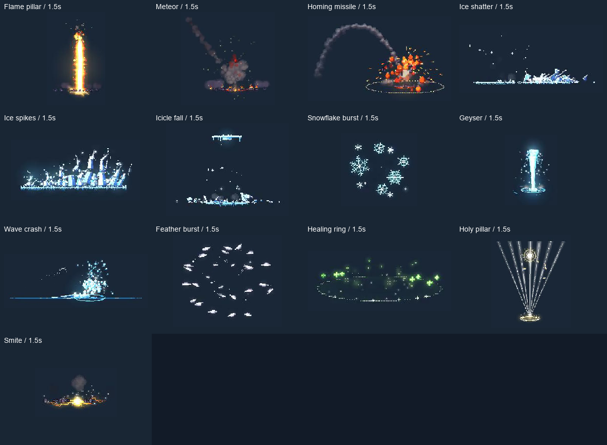

# PixelFX for Godot

**基于 [patch-gg/pixelfx](https://github.com/patch-gg/pixelfx) 的非官方 Godot 移植。** 原作者为 Patch 与 Hugo Duprez，采用 MIT 协议；此仓库由 norvancc 独立维护。

[English](README.md) · [发行包](https://github.com/norvancc/pixelfx-godot/releases) · [API](addons/pixelfx/docs/API.md) · [新增特效](addons/pixelfx/docs/EFFECTS.md)

[观看首批 20 项预览](https://github.com/user-attachments/assets/f7feadf1-6fd1-4d19-8569-fe567e98bd2b)

## 当前状态

当前源码已验收 **52/244** 个上游算法，剩余 **192** 个，共有 **53 个预设**。其中 30 项为解析循环，22 项为独立有状态一次性效果。Arcane Fireball 是 Fireball 的换色预设，不计为额外算法。[完整效果与预设目录](addons/pixelfx/docs/CATALOG.md)列出每项的生命周期和绘制层。

最新发行版仍为 **0.2.0**，包含 Fireball 火球、Ice lance 冰枪、Laser bolt 激光弹、Sunburst 日芒和 Ripples 水面涟漪五项。B1 六项、B2 首批二十项、冰水八项及本批十三项模拟效果均为未发布源码。

B1 新增命中火花、消散烟团、篝火、火箭、小爆炸和水花。B2 首批为 7 项火焰、10 项弹体/枪口、3 项水系，冰水批次另增 3 项冰系、5 项水系，本批再增 13 项模拟效果，原计划 B2 的 49 项还剩 8 项。详见 [B2 本批说明](docs/plans/b2-twenty-review.zh-CN.md)、[验收记录](addons/pixelfx/validation/b2.json)和[迁移台账](docs/migration-status.json)。

冰水八项的[验收说明](docs/plans/b2-elements-review.zh-CN.md)与[机器记录](addons/pixelfx/validation/b2-elements.json)独立保存。当前十三项的[验收说明](docs/plans/b2-simulations-review.zh-CN.md)与[机器记录](addons/pixelfx/validation/b2-simulations.json)记录模拟行为和性能。

解析效果支持 seek、共享帧缓存和预热；有状态效果自动结束、调参重播，不支持这三项能力。所有效果均可调色、变速、暂停、翻转与淡出；各项是否支持前后分层见效果目录；两层读取同一模拟时刻。移动、碰撞、伤害和停止时机由游戏负责。

这是真正的 GDScript CPU 程序生成，生成后通过纹理交给 Godot 绘制；不是 GPU Shader 移植、JS 包装或预录图集。运行时不依赖 Node.js、C#、Autoload 或外部图片。

已包含预设资源与参数校验、实例隔离、完整播放控制、前后分层、共享缓存、预热、对象池、编辑器实时预览、时间轴、调参保存、扩展模板及测试。

## 安装和运行

1. 使用已发布五项时，从 Releases 下载 0.2.0 插件 ZIP；使用当前全部 52 项时，克隆仓库 `main`，将其中的 `addons/pixelfx` 复制到项目。
2. 项目设置 → 插件 → 启用 PixelFX，可获得底部编辑器预览面板；运行时无需启用插件。
3. 添加 PixelFXPlayer2D 节点，将 `presets/fireball.tres` 赋给 Effect。
4. 也可以克隆完整仓库，用 Godot 打开 `project.godot` 后按 F5 运行五效果图鉴，可切换特效和参数。

图鉴右上角 **B1 · 六种新特效** 和 **B2 · 20 种新特效** 可分别打开新增效果，也可直接运行 `demos/pixelfx/b1_gallery.tscn` 或 `demos/pixelfx/b2_gallery.tscn`。**B2 · 冰水八项** 打开 `demos/pixelfx/b2_elements_gallery.tscn`；**B2 · 模拟十三项** 打开 `demos/pixelfx/b2_simulations_gallery.tscn`。

角色挂点、移动、碰撞和伤害由游戏负责，库负责视觉效果；示例在 `demos/pixelfx/projectile_example.gd`。

## 后续扩展

新特效实现统一的 metadata、parameter_schema、bounds、draw 接口，即可被编辑器发现并由同一播放器播放。有状态效果增加 update。专用模拟、组合或角色演出依赖仍须随相应效果移植，不代表这些上游模块已经完成。

详细说明：[API](addons/pixelfx/docs/API.md)、[效果制作](addons/pixelfx/docs/EFFECTS.md)、[路线图](ROADMAP.md)。

## 验证与性能边界

目标 Godot 4.3+；本地实测为 4.7.2 / macOS / GL Compatibility，此前 31 项的 [4.3 Linux headless CI](https://github.com/norvancc/pixelfx-godot/actions/runs/42574117517) 已通过完整检查；新增十三项模拟效果的 Linux CI 待本批 PR 验证。其他平台、版本、渲染器不能自动视为通过。

当前完整 gate 包含 447 组基线、809 组 B1、2607 组 B2 上游 RGBA 对照，另增 1052 组冰水对照，以及本批 2166 组模拟对照，共 **7081 组，零失败**。B2 的 2470 组字节完全一致，8 个超默认阈值案例逐项登记 1–2/255 的量化误差；未统一放宽整体门槛。另有 B2 运行/图鉴 419 项、参数/边界 431 项、编辑器总计 211 项及 B2 重播 320 次。冰水批次另有 167 项运行检查、333 项目录/边界检查和 128 次重播；722 组字节一致、66 个超默认阈值案例逐项审计。模拟本批另有 300 项运行检查、392 项目录/边界检查和 208 次重播，2066 组字节一致、4 个 RGB 量化案例逐项审计。历史结果和完整误差边界见 [VALIDATION.md](addons/pixelfx/VALIDATION.md)。

[B2 PR #6](https://github.com/norvancc/pixelfx-godot/pull/6) 已合并，提交 `112d5d4`；实现提交 `73560f4` 的 Linux CI 与本地验收通过，合并后的代码树一致。本批插件禁用时的干净项目安装验证覆盖 52 项 / 53 个预设。

0.2.0 五种效果的历史冷生成均值约 3.7–28 ms/帧；B1/B2 另有逐项测量，部分火焰、烟雾或爆炸超过 33.3 ms。B2 每项只测四个默认时刻，不能当作穷举峰值。默认共享缓存仍为 32 MiB；预热只适用于解析效果，固定帧率录制不代表实时帧率或并发 GPU 保证，见 [性能说明](addons/pixelfx/docs/PERFORMANCE.md)。

开发验证：`python3 tools/pixelfx/check.py`；打包：`python3 tools/pixelfx/package_demo.py`。需要 Python、Godot 和用于上游参考的 Node.js。

## 开源协作

贡献请阅读 [CONTRIBUTING.md](CONTRIBUTING.md)。保留上游署名、许可和来源记录；新增特效需提供参数、时序、分层、边界、正常速度视觉对照与性能验证。不要只凭脚本解析成功声称迁移完成。

文档与目录说明：[文档索引](docs/README.md)。macOS 快捷启动脚本位于 `scripts/macos/`。
