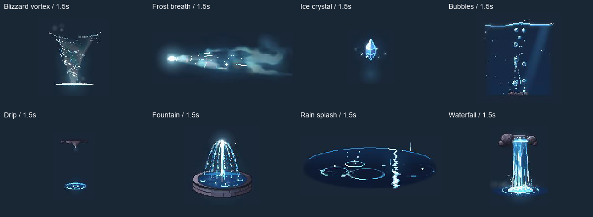

# B2 冰水八项迁移与验收

固定基线仍为 PixelFX 0.3.0 / `a84159688af3ca37a4be05a0d422b94451b2e24e`。本批八项均为原算法的 GDScript 解析循环；累计 **39/244** 算法、**40 个预设**，剩余 **205** 项。B2 已完成 **28/49**，剩余 21 项。最新发行包仍为 0.2.0 的五项。

| 本批上游效果 | 四个默认时刻冷绘制最大值 / ms |
| --- | ---: |
| `ice/blizzard-vortex` | 17.531 |
| `ice/frost-breath` | 94.041 |
| `ice/ice-crystal` | 6.709 |
| `water/bubbles` | 21.930 |
| `water/drip` | 4.331 |
| `water/fountain` | 18.073 |
| `water/rain-splash` | 32.196 |
| `water/waterfall` | 79.567 |

## 实现与验证

保留上游所有选项、随机调用顺序、流体岩石/水雾结构和前后层。五项水系在同一时间分别绘制 back/front；Drip 的 source 与 Waterfall 的 ledge 可关闭。Frost breath 边界覆盖 power/spread 极值。新增原生数组/typed-buffer、回调与 `hypot` 数值适配；前 31 项实现文件与验收哈希保持有效。运行时不依赖 JS 或预录帧。

- 新增 1052 组独立上游 RGBA 对照，覆盖默认整周期、多 seed、逐参数最小/最大值、配色、深浅背景、图层和变换。722 组字节一致；其余限定在逐案例数值误差内。
- 66 个超过默认门槛的案例在 `tests/pixelfx/batches/b2-elements.json` 逐项记录通道上限、差异字节数、总误差与像素矩形，最大通道误差 2/255。默认门槛保持 1/255、20 个通道字节。Rain splash 的追踪定位到混色 alpha 的七个 ULP 差异；未整体放宽容差。
- 167 项运行/图鉴检查、333 项目录/参数/边界检查、128 次重播均通过；完整 gate 保留此前全部测试，合计 **4915** 组像素对照和 **159** 项编辑器检查。两轮重播对象数相同，静态内存增量 1456 字节。
- `tests/pixelfx/batches/` 声明本批范围，通用 reference/parity/runtime/catalog/soak 自动进入 `check.py`；验收工具要求完整默认周期参考、完整原生录像和源码哈希。台账构建器同时读取剩余清单与已验收批次，修复计划附录仅列剩余项后无法重建的问题。

## 原生视觉与安装

本地为 Apple M4 Pro / macOS / Godot 4.7.2 / GL Compatibility。`demos/pixelfx/b2_elements_gallery.tscn` 录制 **1120×740、30 FPS、1572 个解码帧、52.4 秒**，逐项覆盖完整周期/接缝、深浅背景、镜像和前后遮挡；已按 1× 速度播放到结束并检查生命周期图。额外参数极值录像为 786 帧、26.2 秒，覆盖所有数字参数最大值、light=3、seed=-923 及关闭 source/ledge，八项截图均已检查。

视频本地路径为 `builds/pixelfx/b2-elements-native.mp4` 和 `b2-elements-extremes.mp4`，SHA-256 记录于 [验收 JSON](../../addons/pixelfx/validation/b2-elements.json)。固定 30 FPS 输出用于视觉验收，不能视为实时性能保证。Frost breath 和 Waterfall 的四次采样已超过 33.3 ms，其他时刻/参数仍可能更慢；32 MiB / 256 帧默认缓存不变。

独立 addon 与完整源码归档均做内容检查；干净项目禁用编辑器插件时验证全部 39 项 / 40 个预设的加载、实例化与播放。本地完整 gate 已通过；Godot 4.3/Linux [完整 CI](https://github.com/norvancc/pixelfx-godot/actions/runs/42592448679)已通过，其他平台未验收。来源见 [provenance.json](../../addons/pixelfx/provenance.json)，逐项进度见[迁移台账](../migration-status.json)。

Linux Godot 4.3 的 1052 组对照已补充逐像素审计。四个既有例外案例的计数/矩形取两平台并集；所有 alpha 字节相同，最大 RGB 差仍为 2/255。证据归档 SHA-256 为 `f6cb96f385bf153a249bbf3d6947a5083e8f1b69bd2b7109bb113b82be17ffe5`；更新后的[完整 CI](https://github.com/norvancc/pixelfx-godot/actions/runs/42592448679)已通过，验收归档 SHA-256 为 `273ceb7b0c623af7665d28bec72724f34a6d8856dfe945dfc9e9a2743084f818`；本批已合并 [PR #8](https://github.com/norvancc/pixelfx-godot/pull/8)（`7ea9ea6`）。
