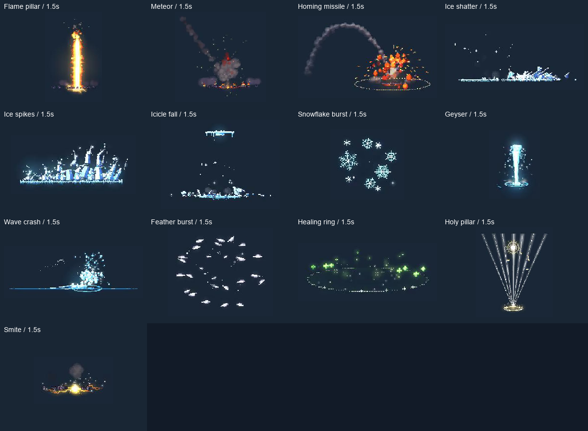

# B2 模拟十三项迁移与验收

固定基线为 PixelFX 0.3.0 / `a84159688af3ca37a4be05a0d422b94451b2e24e`。本批 13 项均为独立有状态一次性效果；源码累计 **52/244** 个算法、**53 个预设**，剩余 **192** 项。B2 为 **41/49**，最后 8 项需要角色输入与演出支持。最新发行包仍为 0.2.0 的五项。

| 上游效果 | 四个默认时刻冷绘制最大值 / ms |
| --- | ---: |
| `fire/flame-pillar` | 134.781 |
| `fire/meteor` | 60.189 |
| `projectiles/homing-missile` | 27.853 |
| `ice/ice-shatter` | 16.888 |
| `ice/ice-spikes` | 51.790 |
| `ice/icicle-fall` | 5.583 |
| `ice/snowflake-burst` | 15.111 |
| `water/geyser` | 82.302 |
| `water/wave-crash` | 25.311 |
| `holy/feather-burst` | 13.795 |
| `holy/heal-aoe` | 32.958 |
| `holy/holy-pillar` | 54.729 |
| `holy/smite` | 17.309 |

## 实现与验证

保留上游逐步模拟、随机调用顺序、分层与全部选项。新增冰片飞行/翻滚/反弹/滑动/碎裂、羽毛飘落、旋转弹体绘制和火焰模拟分层；沿用原生粒子与水系依赖。Typed buffer 保留 Float32 和 Uint8 写入语义，位运算使用 JS 的有符号 32 位规则。回调持有弱引用，避免模块和模拟系统形成资源环。

- 新增 **2166** 组上游独立 RGBA 对照，**2066** 组字节一致；默认整生命周期、多 seed、逐参数最小/最大值、调色、背景、图层、变换、停止及 30/60/120 Hz 更新均覆盖。
- 四个超默认门槛案例逐项记录通道误差、字节数、总误差和矩形。只出现少量 RGB 量化差，最大 2/255，全部 alpha 字节相同；默认门槛仍为 1/255、20 个通道字节。
- 300 项运行/图鉴检查、392 项目录/参数/边界检查、208 次重播通过。重播两轮对象数持平，静态内存增量 1456 字节。完整 gate 保留此前所有测试，合计 **7081** 组对照、**211** 项编辑器检查。
- `count` 和 `shafts` 为整数参数；模拟每次播放隔离，按时结束，改参重播，不能 seek/共享帧缓存/预热。

## 原生视觉与边界

本地为 Apple M4 Pro / macOS / Godot 4.7.2 / GL Compatibility。默认录像为 **1120×740、30 FPS、3220 个解码帧、107.333333 秒**，已按 1× 速度播放到结束，并检查两种背景、镜像、完整生命周期及结束清理、前后遮挡的全部生命周期截图。额外参数最大值录像为 **1610 帧、53.666667 秒**，包括 light=3、seed=-923；十三项画面均已检查。

固定帧率录像只用于视觉验收，不代表实时 FPS。上表只取四个默认时刻的 `draw()`，不含完整模拟更新、纹理上传或 GPU 合成，也不是穷举峰值。32 MiB / 256 帧默认共享缓存不变；本批模拟不使用共享帧缓存。

机器验收见 [b2-simulations.json](../../addons/pixelfx/validation/b2-simulations.json)，图鉴为 `demos/pixelfx/b2_simulations_gallery.tscn`。干净项目插件禁用时的安装验证覆盖全部 52 算法 / 53 预设；两个源码归档均检查内容。Godot 4.3/Linux 检查记录见 [PR #9](https://github.com/norvancc/pixelfx-godot/pull/9/checks)；其他平台、渲染器和完整应用导出未验收。

本批 Flame pillar、Meteor、Ice spikes、Geyser 和 Holy pillar 的冷绘制采样超过 33.3 ms；其他时刻和参数仍可能更慢。

[完整正常速度原生预览](https://github.com/user-attachments/assets/6d2cb744-abb6-4832-ac10-51044966b747)。本批实现及验收通过 [PR #9](https://github.com/norvancc/pixelfx-godot/pull/9) 交付。
