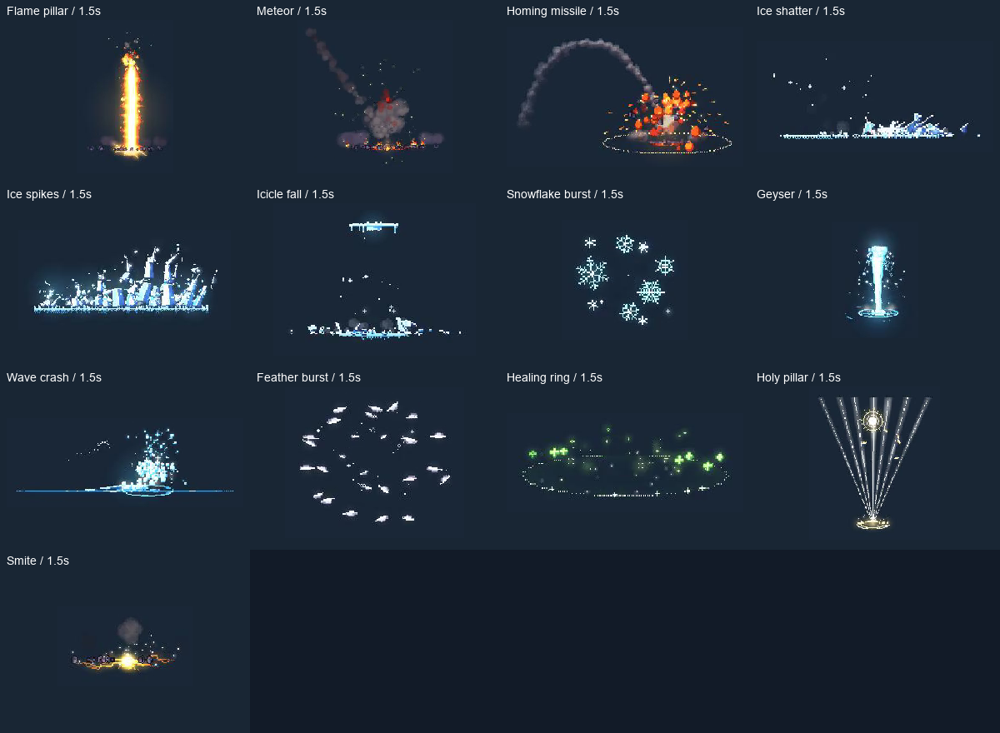

# PixelFX for Godot

给 Godot 项目使用的原生像素特效库。火焰、冰霜、闪电、法术、打击、天气、过场和拾取效果，都以 GDScript 算法和 `.tres` 预设交付。

[宣传页](https://pixelfx-godot.craftypatio2.chatgpt.site) · [下载源码](https://github.com/norvancc/pixelfx-godot/archive/refs/heads/main.zip) · [English README](https://github.com/norvancc/pixelfx-godot/blob/main/README.md) · [中文说明](https://github.com/norvancc/pixelfx-godot/blob/main/README.zh-CN.md)

## 从这里开始

| 要做什么 | 页面 |
| --- | --- |
| 安装插件、播放第一个效果 | [Getting Started](https://github.com/norvancc/pixelfx-godot/wiki/Getting-Started) |
| 找效果、找预设、打开图鉴 | [Effect Catalog](https://github.com/norvancc/pixelfx-godot/wiki/Effect-Catalog) |
| 控制播放、改参数、处理前后层 | [API and Integration](https://github.com/norvancc/pixelfx-godot/wiki/API-and-Integration) |
| 看性能、迁移和验证边界 | [Performance and Status](https://github.com/norvancc/pixelfx-godot/wiki/Performance-and-Status) |
| 了解原作者和许可 | [Credits](https://github.com/norvancc/pixelfx-godot/wiki/Credits) |

## 当前版本

2026-11-10，[全量迁移 PR #10](https://github.com/norvancc/pixelfx-godot/pull/10) 已合并到 `main`（`183118a`），Godot 4.3 / Linux CI 通过。源码共有 **244 个算法、245 个预设**；完整验收仍为 **52/244**。新增项目已有基础运行与部分深入检查，但还不能等同于所有参数、平台和实时性能均完成验收。

最新正式发行包仍是 **0.2.0，含五个算法**。想试全部效果，请下载或克隆 `main`，再复制其中的插件目录。

Wiki 是使用入口。完整 API、目录和带哈希的验证记录以仓库文档为准，避免两个位置维护出不同版本。
